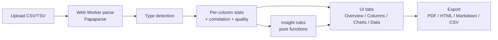

<div align="center">


# Insightlet

### Drop a CSV. Get the story.

[](https://github.com/your-org/insightlet/actions/workflows/ci.yml)
[](LICENSE)
[](tsconfig.json)
[](TEST_REPORT.md)

</div>

Insightlet is a privacy-first, browser-only data profiling tool. Drop in a CSV and instantly see column types, a data quality score, per-column statistics, auto-generated charts, a correlation heatmap, and plain-English "Whispers" insights. **Files never leave your browser** — all parsing and analysis run locally in a Web Worker.

## Features

- **Upload** — drag-and-drop or file picker, auto-detects delimiter (comma, semicolon, tab, pipe), accepts `.csv`/`.tsv`, up to 20 MB, with progress and cancel.
- **Sample data** — three built-in datasets (student grades, e-commerce sales, messy customers).
- **Type detection** — number, integer, text, category, boolean, date, identifier — with manual per-column override.
- **Overview cards** — rows, columns, missing cells, duplicate rows, estimated size, and columns per type.
- **Data quality score (0–100)** — a transparent gauge with a letter grade and a "How is this calculated?" breakdown.
- **Per-column profiles** — full numeric stats (mean, median, mode, std, variance, quartiles, IQR, skewness, outliers, zeros, negatives), category top values, date ranges, and text metrics.
- **Charts** — histograms (adjustable bins), category bars (top 10 + Other), time series (day/week/month × sum/mean/count), scatter plot, Pearson correlation heatmap, and box-plot summaries. Every chart has a text summary and a Download PNG button.
- **Whispers** — 8–12 ranked, plain-English insights (Info / Warning / Discovery), each a pure function in its own file; click to jump to the related column or chart.
- **Cleaning helpers** — remove duplicates, drop sparse columns, trim whitespace, standardize casing, with a before/after quality score and cleaned-CSV download.
- **Data table** — search, sort, per-column filter, virtualized for 50,000+ rows, sticky header, column show/hide, with missing/outlier highlighting.
- **Export** — PDF report, standalone HTML report, and insights as Markdown.
- **UI/UX** — light/dark mode (remembered + system-aware), responsive to 360px, loading skeletons, toasts, tabs, and keyboard shortcuts (`/`, `d`, `?`).
- **Resilient** — friendly, specific error handling and a global error boundary.

## Tech stack

| Area | Choice |
| --- | --- |
| Framework | Next.js 14 (App Router), static export |
| Language | TypeScript (strict, no `any`) |
| Styling | Tailwind CSS |
| Charts | Recharts |
| CSV parsing | Papaparse in a Web Worker |
| Table | @tanstack/react-virtual |
| Export | jsPDF + html2canvas |
| Testing | Vitest + React Testing Library |
| Tooling | ESLint, Prettier, Husky, GitHub Actions |

## Privacy

Insightlet has no backend and no database. Your file is read, parsed, and analyzed entirely in your browser. Nothing is uploaded, stored, or transmitted.

## How it works



## Setup

Requires **Node.js 20+**. See [SETUP.md](SETUP.md) for full details and troubleshooting.

```bash
npm install
npm run dev
# open http://localhost:3000
```

## Scripts

| Script | What it does |
| --- | --- |
| `npm run dev` | Start the dev server at http://localhost:3000 |
| `npm run build` | Build a static production site into `out/` |
| `npm run start` | Serve the production build |
| `npm run lint` | ESLint (next/core-web-vitals + typescript) |
| `npm run format` | Format with Prettier |
| `npm run typecheck` | TypeScript type check (no emit) |
| `npm run test` | Run the Vitest suite once |
| `npm run test:coverage` | Run tests with a coverage report |

## Testing

```bash
npm test                 # 163 unit, edge, property, and component tests
npm run test:coverage    # coverage report (thresholds enforced)
npm run test:perf        # 50k x 30 performance smoke test
npm run test:e2e:install # one-time: download the Playwright browser
npm run test:e2e         # end-to-end + accessibility, desktop + mobile
```

The suite has **163 unit + component tests** plus **12 Playwright E2E/accessibility
tests** across desktop and a 375px mobile viewport. Coverage of the pure logic in
`src/lib` is **95.8% statements / 100% functions**, with enforced thresholds of 90%
for `src/lib/analysis` and `src/lib/insights` and 70% overall.

Coverage spans delimiter and type detection, all descriptive statistics, outliers,
Pearson correlation, duplicates, missing values, the quality score and its
components, every insight rule (one file per rule, triggering and non-triggering
cases), all cleaning actions, and the CSV/Markdown/HTML exports (including CSV
formula-injection protection). Edge cases, property-based invariants (fast-check),
and a 50k × 30 performance smoke test round it out.

See [TEST_REPORT.md](TEST_REPORT.md) for the full breakdown, performance numbers,
and the two bugs the tests surfaced and fixed (CSV formula injection and BOM
handling).

## Folder structure

```
src/
├── app/                 # Next.js routes, layout, error boundary, global CSS
├── components/
│   ├── charts/          # Histogram, CategoryBar, Scatter, TimeSeries, Heatmap, Box
│   ├── panels/          # Overview, Columns, Charts, Whispers, Clean, Data tabs
│   ├── providers/       # Theme + Toast context
│   └── ui/              # Logo, Card, Badge, Header, Sparkline, Skeleton
├── data/                # Built-in sample datasets
├── hooks/               # useCsvParser (owns the worker)
├── lib/
│   ├── analysis/        # PURE typed functions: detection, stats, correlation, quality, cleaning
│   ├── export/          # pdf, html, markdown, csv
│   └── insights/        # one rule per file + a runner
├── types/               # Shared Dataset / ColumnProfile / Insight types
└── workers/             # CSV parser Web Worker
tests/                   # Vitest unit + component tests, fixtures
docs/                    # Functional requirements + SRS
```

## Design decisions

These were decided during the build to keep everything local, fast, and portfolio-grade:

- **Next.js static export (`output: 'export'`).** No backend is needed, so the app builds to static files deployable to Vercel or any static host, reinforcing the privacy story.
- **Analysis engine is React-free.** Everything in `src/lib/analysis` and `src/lib/insights` is pure and typed, which makes it trivially testable and reusable. The UI only renders results.
- **Web Worker parsing.** Papaparse runs in a worker with streaming progress so a 50k-row file never blocks the main thread. A 30s timeout guards against pathological input.
- **One insight rule per file.** Each rule is a pure `(dataset) => Insight[]` function registered in a single array, so adding a rule is a one-file change plus one import.
- **Transparent quality score.** Four weighted components (completeness 40%, uniqueness 20%, consistency 20%, outliers 20%) are shown explicitly rather than hidden behind a magic number.
- **International date ambiguity resolved to DD/MM** when a date like `05/06/2024` is ambiguous, since that is the more common global convention; unambiguous dates (a part > 12) are parsed correctly either way.
- **Virtualized table over pagination.** @tanstack/react-virtual keeps scrolling smooth at 50k+ rows without the UX cost of paging.
- **Recharts** for charts and a hand-rolled SVG for the correlation heatmap and box summaries, where a grid/box renders more cleanly and accessibly than a charting primitive.
- **No `any`.** Strict TypeScript throughout, with shared domain types as the single source of truth.
- **`metadataBase`** points at a placeholder Vercel URL so Open Graph images resolve; change it to your deployed domain.

## Screenshots

> Placeholders — drop real captures in `docs/screenshots/` when deploying.

| Landing | Overview | Charts | Whispers |
| --- | --- | --- | --- |
| _hero + upload_ | _quality gauge + cards_ | _histograms + heatmap_ | _ranked insights_ |

## Future improvements

- AI chat with your data (local LLM or bring-your-own-key)
- Excel (`.xlsx`) and JSON input support
- Shareable, encrypted report links
- Saved sessions via IndexedDB
- More chart types (violin, parallel coordinates, geo)

## License

[MIT](LICENSE)
